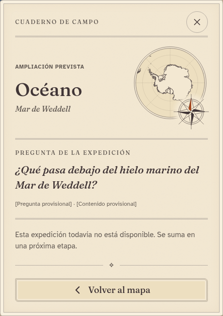

# Antártida por descubrir · Sistema de diseño

## Overview

La interfaz es un cuaderno de expedición para divulgación y educación: cálido, sobrio y cartográfico. El pergamino claro y la tinta marrón neutra construyen su identidad; la geografía, las preguntas y las observaciones organizan el contenido. Tiene que transmitir exploración y cuidado documental, con lectura clara en escritorio y celular.

La dirección vigente es la propuesta «Pergamino claro» de la ficha real «Océano», aprobada el 15 de noviembre de 2026. Conserva la composición de la primera referencia —marcos dobles, carta de Antártida, rosa y tipografías— con un soporte marfil claro, textura tenue y sombra suave. La segunda referencia blanca cálida y la prueba ocre intensa se conservan como comparadores históricos.



[Referencia ocre histórica](docs/diseno/referencias/ficha-cartografica-v2.png) · [CSS del prototipo aprobado](docs/diseno/referencias/ficha-oceano-pergamino-claro.css) · [Componente](packages/react-ui/src/map/PointSheet.tsx) · [CSS estructural](packages/core/src/styles/point-sheet.css).

**Estado:** dirección visual aprobada y aplicada en la rama `202-ui-pergamino-claro` para el issue #202. La ficha prototipo está verificada en 456 × 645 px. La validación automatizada registrada para esta entrega reúne 1.356 pruebas (`19` documentales, `650` de `core` y `687` de `react-ui`), además de `pnpm typecheck` y `pnpm build` sin errores. La E2E global de 82 casos sigue en curso y presenta fallos; no se declara como una suite verde ni como cobertura visual global completa. El material común vive en `tokens.css` y `cartography.css`; los layouts conservan sus hojas específicas. El [plan de migración](docs/diseno/plan-migracion-ui.md) separa implementación, evidencia y límites de validación.

### Formato y procedencia

Este archivo adopta la [especificación abierta DESIGN.md de Google Labs, versión alpha](https://github.com/google-labs-code/design.md/blob/main/docs/spec.md), consultada el 15 de noviembre de 2026. Usa metadatos YAML, tokens en bloques YAML y las ocho secciones canónicas en su orden. Se mantienen los encabezados en inglés para su reconocimiento por herramientas y el contenido en español. Es un formato en desarrollo, no un estándar universal ratificado.

Se eligió porque define un contrato de archivo verificable. La [guía de Claude Design](https://support.claude.com/en/articles/14604397-set-up-your-design-system-in-claude-design) consultada describe la extracción de colores, tipografía, componentes y layouts, pero no prescribe un esquema equivalente de `DESIGN.md`. El [formato DTCG 2025.10](https://www.designtokens.org/tr/2025.10/format/) sirve para intercambiar tokens; no sustituye la documentación de intención visual. Estas dos fuentes también se consultaron el 15 de noviembre de 2026.

Los valores proceden del CSS local y las capturas aprobadas. La imagen de mapa antiguo aportada por el usuario es una referencia estética, no un recurso incorporado. Se reutilizan la textura local y las costas de Natural Earth, con las [atribuciones del proyecto](README.md#fuentes-y-licencias).

## Colors

```yaml
colors:
  primary: "#403536"
  secondary: "#655D56"
  neutral: "#F3E8D2"
  surface: "#EDDFC0"
  rule: "#B9B0A5"
  accent: "#A4471F"
  interaction: "#1E3E5C"
```

| Token | Nombre visual | Función |
| --- | --- | --- |
| `primary` | Tinta marrón neutra | Títulos, texto principal, costas y contornos que deben reconocerse. |
| `secondary` | Gris marrón de anotación | Texto secundario, rótulos y fuentes; conserva legibilidad sin volver gris la pregunta principal. |
| `neutral` | Pergamino claro | Base del papel y relleno de tierra en la viñeta. |
| `surface` | Aguada marfil | Botón en reposo y agua de la viñeta; aporta calidez sin acercarse al ocre intenso. |
| `rule` | Filete gris cálido | Líneas decorativas y marco interior; no usar como texto ni como único indicador de un control. |
| `accent` | Óxido cartográfico | Aguja decorativa de la rosa; no significa error ni una medición. |
| `interaction` | Azul profundo | Hover del botón principal y foco visible. |

Los cinco primeros valores son los valores explícitos del prototipo aprobado, expresados en hexadecimal para que la referencia sea reproducible. Correspondencia: `primary` → `--chart-ink`, `secondary` → `--chart-muted`, `neutral` → `--chart-paper`, `surface` → `--chart-wash`, `rule` → `--chart-rule`. `accent` y `interaction` conservan `--oxide` y `--deep`; el mapeo semántico se mantiene aunque la paleta vigente ya no dependa de una normalización de `color-mix()`.

La referencia aprobada usa `--chart-paper: #F3E8D2`, `--chart-ink: #403536`, `--chart-muted: #655D56`, `--chart-rule: #B9B0A5` y `--chart-wash: #EDDFC0`. La superficie se cubre con un degradado marfil normal al 89% sobre la textura local; esa composición describe el aporte visible de la textura sin atribuirle una opacidad independiente. La sombra combina un marco interior claro, filete cálido y una sombra exterior suave. Estos valores describen la captura aprobada y no rectifican sus radios históricos. La revisión posterior acepta un redondeo común para toda la UI, documentado en `rounded.panel` y `rounded.button`.

La textura y los degradados suavizan estos colores. El pergamino visible es claro y ligeramente cálido, con más presencia en el borde que en el centro. Para reproducirlo, conservar `paper-512.webp` en su tamaño intrínseco de 512 × 512 px (`background-size: auto`), el degradado marfil normal al 89% y la composición vigente de la capa de textura; evitar una mezcla `multiply` oscura. El hexadecimal solo no reproduce la captura.

La paleta gobierna la UI cartográfica. El agua y el hielo de la escena, los gráficos y los instrumentos conservan colores funcionales cuando transmiten información. No se ha definido un tema oscuro ni una nueva paleta de error/éxito; esos estados requieren contraste y señal textual antes de incorporarlos al sistema.

## Typography

```yaml
typography:
  title: {fontFamily: Fraunces, fontSize: 38px, fontWeight: 500, lineHeight: 1.08}
  title-compact: {fontFamily: Fraunces, fontSize: 28px, fontWeight: 500, lineHeight: 1.08}
  question: {fontFamily: Fraunces, fontSize: 22px, fontWeight: 500, lineHeight: 1.4}
  question-compact: {fontFamily: Fraunces, fontSize: 20px, fontWeight: 500, lineHeight: 1.4}
  place: {fontFamily: Fraunces, fontSize: 16px, fontWeight: 500}
  body: {fontFamily: Atkinson Hyperlegible, fontSize: 15px, fontWeight: 400, lineHeight: 1.55}
  label: {fontFamily: Fraunces, fontSize: 12px, fontWeight: 500, lineHeight: 1.4, letterSpacing: 0.16em}
  caption: {fontFamily: Atkinson Hyperlegible, fontSize: 12px, fontWeight: 400, lineHeight: 1.5}
  action: {fontFamily: Fraunces, fontSize: 18px, fontWeight: 500}
```

Fraunces da carácter editorial a títulos y acciones. Atkinson Hyperlegible sostiene cuerpo, fuentes, instrucciones y valores. Ambas se cargan localmente desde `@fontsource`. Caveat ya está disponible, pero se reserva para anotaciones puntuales; no es la tipografía de cifras, unidades o controles necesarios.

La pregunta y el lugar se componen en cursiva. Los rótulos editoriales breves usan mayúsculas espaciadas. Estas propiedades se describen aquí porque `fontStyle` y `textTransform` no forman parte del objeto tipográfico del formato adoptado.

El título de la ficha interpola entre 28 y 38 px mediante `clamp(28px, 5vw, 38px)`; `title-compact` y `title` expresan sus extremos. La pregunta baja a 20 px a 380 px de ancho o menos. Los textos largos crecen en altura, sin elipsis que eliminen información esencial.

Los tamaños representan la ficha aprobada. Las categorías actuales de 11 px y los avisos de 12 px requieren revisión de legibilidad al extender el diseño. No reducir fuentes o advertencias para ganar espacio. Los ejes de gráficos necesitan una escala específica validada en su tamaño real.

## Layout

```yaml
spacing:
  heading-gap: 10px
  margin-mobile: 12px
  margin-desktop: 24px
  section-gap: 18px
  note-gap: 20px
  sheet-top: 22px
  sheet-inline-mobile: 24px
  sheet-inline-desktop: 30px
  sheet-bottom-mobile: 26px
  sheet-bottom-desktop: 28px
```

La composición sigue el orden de una hoja de campo: cabecera y cierre; categoría, título y lugar junto a la viñeta; pregunta o descripción; nota y fuentes; regreso al mapa. Los textos se alinean a la izquierda. Los filetes separan grupos relacionados sin fragmentar cada frase en otra tarjeta.

La ficha de escritorio tiene 456 px de ancho, margen exterior de 24 px y padding de 22 px arriba, 30 px a los lados y 28 px abajo. En móvil ocupa el ancho disponible menos dos márgenes de 12 px, con padding de 22/24/26 px. No se impone una grilla de 8 px: los tokens registran los espacios efectivos de la referencia.

La cabecera combina una columna de texto flexible con una viñeta cartográfica compacta de 112 px, separadas por 10 px. Hasta 480 px de ancho, la viñeta baja a 96 px; hasta 380 px, el padding horizontal conserva 20 px. La rosa superpuesta mide 60 px, o 52 px en la variante compacta. Reducir primero el adorno cuando compite con el contenido.

La ficha pasa a su layout de escritorio a 820 px de ancho. Su altura máxima deja 12 px libres por borde en móvil y 24 px en escritorio; el contenido puede desplazarse dentro. El mapa se adapta a `100dvh` sin imponer un mínimo de 600 px, para permitir pantallas horizontales bajas. Revisar zonas seguras y texto ampliado.

Las demás superficies adaptan este ritmo a su función: leyenda compacta, índice con filas, panel de expedición con acción persistente y gráfico con área de lectura suficiente. Los paneles de Orcadas mantienen sus tamaños reducido, pequeño y ampliado. La integración con sus otros breakpoints está detallada en el plan de migración.

## Elevation & Depth

La profundidad es la de una hoja apoyada sobre el mapa. El marco y el tono del papel establecen la jerarquía interna; la sombra exterior separa el panel de la escena.

La ficha usa una sombra exterior suave `0 9px 26px rgb(64 53 54 / 15%)`, un borde interior claro de 6 px seguido por un filete a 7 px y una aguada interior tenue. Los bordes tienen variación suave; el centro debe conservar contraste suficiente para leer.

El botón en reposo incorpora un marco interior de papel de 3 px. En hover pierde esa sombra interior y pasa a azul profundo. El cierre no lleva sombra. Las superficies secundarias no necesitan acumular todos los efectos de la ficha principal.

El oscurecimiento del fondo indica una capa modal. Un panel persistente de la expedición sigue perteneciendo a la pantalla y permite explorar la escena. La apariencia de papel por sí sola no determina el comportamiento modal.

## Shapes

```yaml
rounded:
  panel: 13px
  button: 9px
  focus: 2px
  circular: 9999px
```

La dirección aceptada para toda la UI usa `rounded.panel: 13px` en paneles flotantes y `rounded.button: 9px` en botones rectangulares. Se aplica a las superficies de lectura y acciones que comparten estos tokens. Los controles circulares y los chips conservan su forma semántica; los gráficos, los separadores y las esquinas de superficies pegadas al borde de la pantalla conservan su tratamiento propio.

**Histórico de la revisión anterior:** la ficha conservaba exactamente `border-radius: 7px 3px 8px 4px / 4px 8px 3px 6px` y el botón principal `2px 7px 3px 6px`. Esos valores explican las capturas previas y quedan etiquetados como referencia histórica; no representan la dirección 13/9 aceptada posteriormente.

Los controles circulares conservan esa forma; `circular` representa un círculo sobre una caja cuadrada. **Histórico de la referencia anterior:** el cierre medía 44 × 44 px. El foco visible usa contorno azul de 3 px, separado 3 px, con radio de 2 px.

Los filetes simples miden 1 px; los dobles, 3 px en total. La rosa y la viñeta son SVG decorativos, con contornos de tinta y aguja de óxido. Las formas interactivas tienen un área de pulsación mayor que sus trazos. Los símbolos de disponibilidad y procedencia deben distinguirse también por forma y texto.

## Components

```yaml
components:
  point-sheet:
    backgroundColor: "{colors.neutral}"
    textColor: "{colors.primary}"
    rounded: "{rounded.panel}"
  point-sheet-desktop:
    width: 456px
  point-sheet-title:
    textColor: "{colors.primary}"
    typography: "{typography.title}"
  point-sheet-title-compact:
    typography: "{typography.title-compact}"
  point-sheet-question:
    textColor: "{colors.primary}"
    typography: "{typography.question}"
  point-sheet-question-compact:
    typography: "{typography.question-compact}"
  point-sheet-place:
    textColor: "{colors.secondary}"
    typography: "{typography.place}"
  point-sheet-note:
    backgroundColor: "{colors.neutral}"
    textColor: "{colors.secondary}"
    typography: "{typography.body}"
  editorial-label:
    textColor: "{colors.secondary}"
    typography: "{typography.label}"
  provenance-note:
    backgroundColor: "{colors.neutral}"
    textColor: "{colors.secondary}"
    typography: "{typography.caption}"
  button-primary:
    backgroundColor: "{colors.surface}"
    textColor: "{colors.primary}"
    typography: "{typography.action}"
    rounded: "{rounded.button}"
  button-primary-hover:
    backgroundColor: "{colors.interaction}"
    textColor: "{colors.neutral}"
  button-close:
    textColor: "{colors.primary}"
    size: 44px
    rounded: "{rounded.circular}"
  button-close-hover:
    backgroundColor: "{colors.surface}"
    textColor: "{colors.primary}"
  button-focus:
    rounded: "{rounded.focus}"
  decorative-rule:
    backgroundColor: "{colors.rule}"
  compass-needle:
    textColor: "{colors.accent}"
  atlas-header:
    backgroundColor: "{colors.neutral}"
    textColor: "{colors.primary}"
  atlas-index:
    backgroundColor: "{colors.neutral}"
    textColor: "{colors.primary}"
  voyage-sheet:
    backgroundColor: "{colors.neutral}"
    textColor: "{colors.primary}"
  expedition-panel:
    backgroundColor: "{colors.neutral}"
    textColor: "{colors.primary}"
  source-panel:
    backgroundColor: "{colors.neutral}"
    textColor: "{colors.secondary}"
```

Los componentes con tokens describen la ficha aprobada y las superficies que comparten su material. Los fondos son sus bases planas: textura, contornos y efectos se completan con las secciones anteriores. La altura del botón principal es **mínima de 48 px**, no fija; se expresa aquí para conservar el crecimiento con texto ampliado.

### Fichas y acciones

La ficha abre con «Cuaderno de campo» y un cierre con nombre accesible. Una acción de ancho completo cierra la hoja o avanza en el contexto correspondiente. Mantener el borde doble del botón, icono y texto explícito. Fuentes y notas conservan jerarquía y espacio propio.

Las acciones secundarias usan contorno simple y papel o fondo transparente. Las opciones seleccionadas combinan tinta oscura, papel claro y un borde distinto, conservando `aria-pressed` o `aria-current`. Los controles deshabilitados conservan su estado semántico y reducen el énfasis. El foco es visible tanto en reposo como sobre un control seleccionado.

### Mapa, lista y navegación

La cabecera toma forma editorial de atlas; el registro, de bitácora; la leyenda, de clave cartográfica. El índice de expediciones usa filas, títulos y divisores. Los controles 2D/3D, zoom y selección comparten acciones y foco, manteniendo sus etiquetas y alternativas por teclado.

La viñeta puede acompañar portadas y fichas principales. No se repite en cada fila o control. Reutiliza las costas existentes; retícula y rosa no son una escala ni una medición. Ornamentos decorativos quedan fuera del árbol accesible.

### Expediciones, datos y formularios

Desde Ushuaia usa hojas de preparación, ruta, avistajes y fuentes. Orcadas usa cabecera de capítulos, tarjetas de parada, calendario e instrumentos integrados al cuaderno. Ambos conservan sus recorridos y controles.

Las etiquetas separan disponibilidad de expedición y naturaleza de la información. Dato real, simulación, cálculo y reconstrucción conservan nombre y símbolo propios. Los gráficos mantienen unidades, ejes, leyendas y colores funcionales. El papel enmarca las mediciones sin cubrirlas de textura.

La ficha no aporta un patrón de campo de texto. Si una pantalla requiere entradas, documentar label, ayuda, error, foco y estados a partir de ese caso real antes de añadir tokens. Las lecturas instrumentales y las opciones seleccionables mantienen sus interacciones actuales.

## Do's and Don'ts

### Hacer

- Mantener el pergamino claro, la tinta marrón neutra y la cartografía como identidad reconocible en cada tamaño de pantalla.
- Reutilizar la textura y las fuentes locales; conservar fuentes científicas, unidades, avisos provisionales y atribuciones.
- Dar prioridad a lectura y controles; reducir ornamentos antes que contenido o áreas táctiles. El objetivo interno de controles pequeños es 44 × 44 px.
- Comprobar contraste sobre el fondo efectivo: 4,5:1 en texto normal y 3:1 en texto grande según la definición de [W3C](https://www.w3.org/WAI/WCAG22/Understanding/contrast-minimum.html). La información visual necesaria de controles y gráficos debe cumplir las condiciones de [contraste no textual](https://www.w3.org/WAI/WCAG22/Understanding/non-text-contrast.html). Fuentes consultadas el 14 de noviembre de 2026.
- La tinta funcional `#1F2A36` sobre el ocre `#C0862F` alcanza nominalmente 4,64:1 y se conserva para etiquetas de 12/13 px. La tinta de Pergamino claro `#403536` sobre ese ocre alcanza 3,76:1 y no se usa para texto pequeño en esa combinación. Son cálculos nominales de color plano: no sustituyen la revisión sobre textura, transparencia o degradados.
- Conservar Escape, foco visible y retorno al origen existentes en cada interacción. No añadir contención de foco ni fondo inerte como parte del rediseño; conservarlos únicamente donde ya estén implementados. Los paneles persistentes conservan acceso al resto de la pantalla. Referencia: [patrón modal de W3C](https://www.w3.org/WAI/ARIA/apg/patterns/dialog-modal/), consultado el 14 de noviembre de 2026.
- Respetar movimiento reducido y alternativa sin WebGL; revisar carga, error, títulos largos y fuentes extensas.
- Verificar el sistema contra las capturas elegidas y la matriz del [plan de migración](docs/diseno/plan-migracion-ui.md). La migración visual conserva el comportamiento de foco del baseline; la validación funcional actual se comprueba por separado. Una auditoría completa de contraste sobre textura sigue siendo una validación aparte.

### Evitar

- Volver a grandes superficies blancas sin calidez o a un ocre intenso que diluya la dirección aprobada.
- Aplicar sepia a toda la escena o cambiar la paleta de datos por decoración.
- Usar filetes tenues como texto, depender solo del color o ocultar avisos para simplificar una ficha.
- Introducir coordenadas, escalas o fuentes inventadas; presentar una reconstrucción como dato real.
- Añadir una brújula por control, envejecimiento que ensucie la lectura o animación continua del papel.
- Reemplazar modelos voxel, geometría, proyecciones o lógica de expedición como consecuencia implícita de este sistema de UI.
- Interpretar la validación del formato como certificación de accesibilidad o evidencia de que toda la aplicación ya fue migrada.
